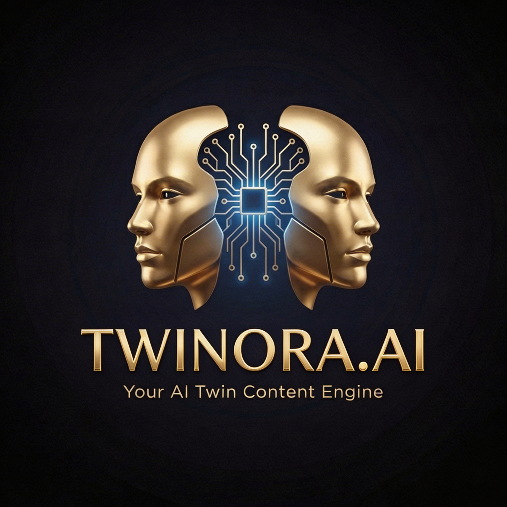
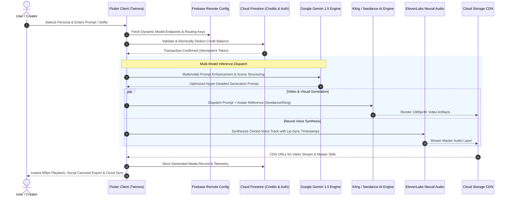

# 🔮 Twinora AI Studio — Production Generative AI Digital Twin, Multimodal Video & Virtual Creative Studio

  

  <strong>Next-Generation Enterprise AI Digital Avatar Synthesis, Cinematic Video Generation, and Automated Creative Studio</strong>

  
  
  
  
  
  
  
  
  
  

---

## 🏛️ Engineering Provenance & Production Verification

> **Dual Production App Store Verification:**
> 
> The core generative AI orchestration engine, multimodal video pipeline, and high-performance client interfaces in this repository are actively deployed and serving real-world users on both premier mobile marketplaces:
> - 🍏 **Apple App Store (iOS):** [**Twinora on Apple App Store (`id6777274197`)**](https://apps.apple.com/us/app/twinora/id6777274197)
> - 🤖 **Google Play Store (Android):** [**Twinora on Google Play (`com.twinora.app`)**](https://play.google.com/store/apps/details?id=com.twinora.app)
> 
> *Principal Mobile Architect & Lead Engineer:* **Muhammad Ali**

---

## 🌟 Executive Overview & Architectural Scope

**Twinora AI Studio** is an enterprise-grade multimodal generative content engine designed for creators, digital marketers, influencers, and brands. The platform transforms a single selfie into a photorealistic, persistent **Digital Twin** capable of generating studio-quality photoshoot collections, lip-synchronized talking-head video broadcasts, cinematic B-roll scenes, and automated high-converting social media carousels.

Rather than relying on a single static AI model, Twinora features a **dynamic multi-model dispatch router** that dynamically delegates workloads across specialized state-of-the-art inference backends:
- **Google Gemini 1.5 Flash & Pro:** Multimodal prompt expansion, contextual scene understanding, and vision-based identity fidelity validation.
- **ByteDance Seedance 2.0 (VolcEngine Ark):** Ultra-low-latency generative video avatars and dynamic camera motion synthesis.
- **Kling AI:** High-definition narrative video sequence generation and physical realism modeling.
- **Fal.ai & Flux:** High-resolution photorealistic diffusion rendering with LoRA identity weights.
- **ElevenLabs & HeyGen:** Neural voice cloning, multilingual accent preservation, and frame-accurate phonetic lip synchronization.

---

## 🏗️ System Architecture & Multi-Model Dispatch Flow

---

## 🚀 Key Feature Modules

### 1. 📸 Photorealistic AI Digital Twin Photoshoots
- **Facial Consistency Engine:** Preserves exact facial structure, skin texture, lighting, and signature personal aesthetics across diverse backgrounds and wardrobe changes.
- **Prompt Intelligence (`GeminiService`):** Analyzes rough user prompts and programmatically expands them into camera-accurate directives (aperture, focal length, volumetric lighting).

### 2. 🎬 Cinematic Video Generation & Talking Avatars
- **Dual Video Pipeline:** Integrates **ByteDance Seedance 2.0** via VolcEngine Ark and **Kling AI** for smooth, artifact-free physical motion and lifelike facial micro-expressions.
- **Speech & Lip Synchronization:** Connects **ElevenLabs** voice cloning with **HeyGen** video rendering to achieve sub-frame audio-visual alignment.

### 3. 🎨 Smart Social Carousel Engine
- **Automated Multi-Slide Layouts (`CarouselExportService`):** Generates cohesive, professional multi-slide visual narratives tailored for Instagram, LinkedIn, and TikTok.
- **Pexels & Dynamic Stock Fusion (`CarouselPexelsService`):** Combines AI-generated portraits with licensed high-resolution contextual imagery.

### 4. 💳 In-App Purchases & Credit Economy (`IAPService`)
- **StoreKit 2 & Google Play Billing:** Seamless in-app subscription management and consumable credit packs.
- **Tier Architecture:** Supports Starter, Plus, Pro, and Business subscription tiers with atomic Firestore balance ledger tracking (`CreditService`).

### 5. ⚡ Dynamic Model & Endpoint Resilience
- **Zero-Downtime Model Routing:** All API endpoints, generation parameters, and fallback engines are controlled dynamically via **Firebase Remote Config**.
- If a provider encounters transient degradation, Twinora automatically reroutes generation jobs to healthy fallback models without requiring an App Store release.

---

## 📂 Production Service Architecture

The core Flutter application (`AI_image_video_generation`) is engineered around a modular, single-responsibility service architecture:

| Service File | Domain / Responsibility | Key Integrations |
|:---|:---|:---|
| [`gemini_service.dart`](lib/services/gemini_service.dart) | Multimodal Prompt Expansion & Vision Verification | Google Gemini 1.5 Flash / Pro |
| [`kling_ai_service.dart`](lib/services/kling_ai_service.dart) | Cinematic Video Storyboard Generation | Kling AI REST API |
| [`seedance_ai_service.dart`](lib/services/seedance_ai_service.dart) | Real-Time Avatar Motion & Talking Head Video | ByteDance VolcEngine Ark |
| [`fal_ai_service.dart`](lib/services/fal_ai_service.dart) | Low-Latency Diffusion & LoRA Image Generation | Fal.ai Fast SD / Flux |
| [`open_ai_service.dart`](lib/services/open_ai_service.dart) | Creative Scriptwriting & Narrative Captioning | OpenAI GPT-4o API |
| [`eleven_labs_service.dart`](lib/services/eleven_labs_service.dart) | High-Fidelity Voice Cloning & Audio Master Tracks | ElevenLabs Neural TTS |
| [`heygen_service.dart`](lib/services/heygen_service.dart) | High-Throughput Lip-Synchronized Avatar Video | HeyGen Streaming API |
| [`iap_service.dart`](lib/services/iap_service.dart) | Cross-Platform In-App Subscriptions & Consumables | StoreKit 2, Google Play Billing |
| [`credit_service.dart`](lib/services/credit_service.dart) | Transactional Ledger & Credit Balance Verification | Cloud Firestore Transactions |
| [`carousel_export_service.dart`](lib/services/carousel_export_service.dart) | High-Resolution Multi-Slide Carousel Generator | Flutter CustomPainter & Canvas |
| [`audio_recording_service.dart`](lib/services/audio_recording_service.dart) | In-App Audio Sample Capture for Voice Cloning | High-Quality Audio Codecs |
| [`fcm_service.dart`](lib/services/fcm_service.dart) | Asynchronous Rendering Completion Notifications | Firebase Cloud Messaging |

---

## 🔒 Security, Privacy & App Store Compliance

1. **Apple App Store Review Guideline 5.1.1(v) Compliance:**
   - Features built-in, explicit account and data deletion workflows that purge stored biometric avatar weights, generation records, and personal identifiers upon request.
2. **Credential Isolation & Sanitization:**
   - Production API keys are strictly governed by server-side Firebase Remote Config parameters, preventing hardcoded secret exposure in compiled client application bundles.
3. **Local Asset Caching & Network Efficiency:**
   - Leverages smart HTTP caching and progressive image streaming to minimize mobile cellular bandwidth consumption.

---

## 👤 Engineering & Architecture Credits

- **Principal Mobile Architect & Lead Engineer:** [**Muhammad Ali**](https://github.com/itismemuhammadali)
- **Primary GitHub:** [@ItIsMeMuhammadAli](https://github.com/itismemuhammadali)
- **Inquiries & Collaboration:** `itismemuhammadali@gmail.com`
